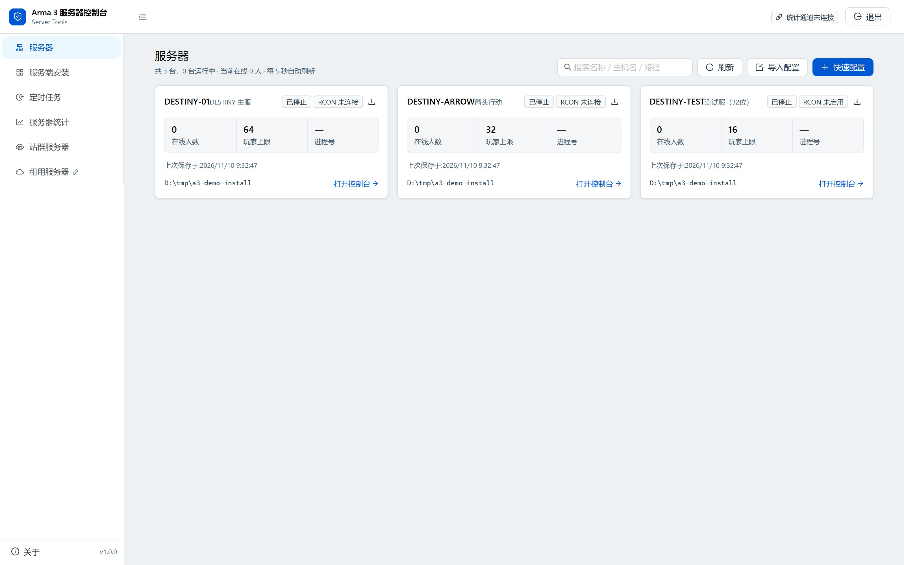
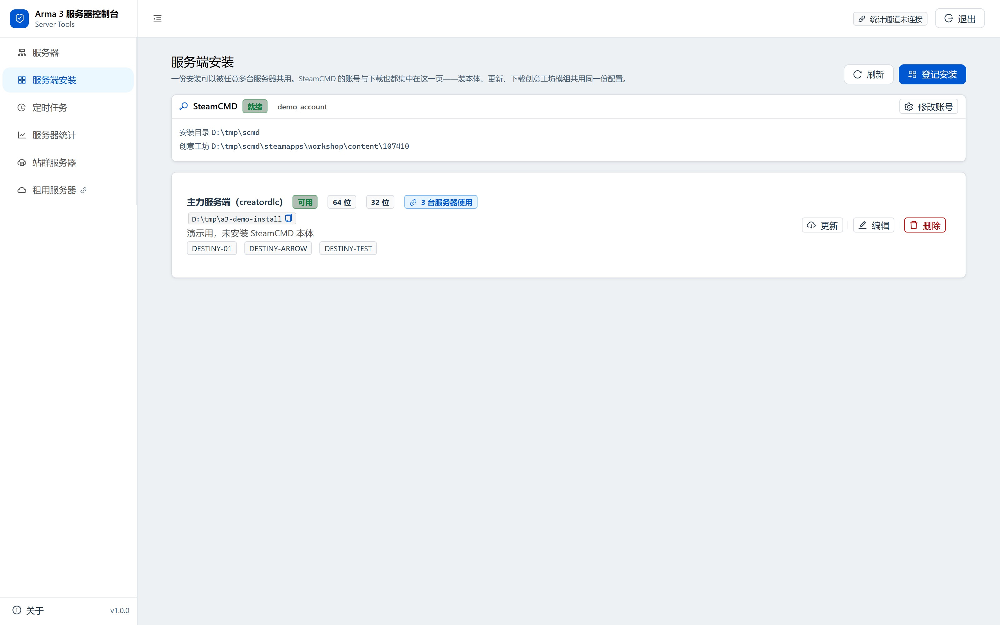
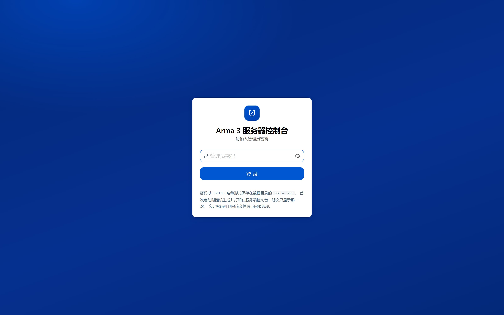
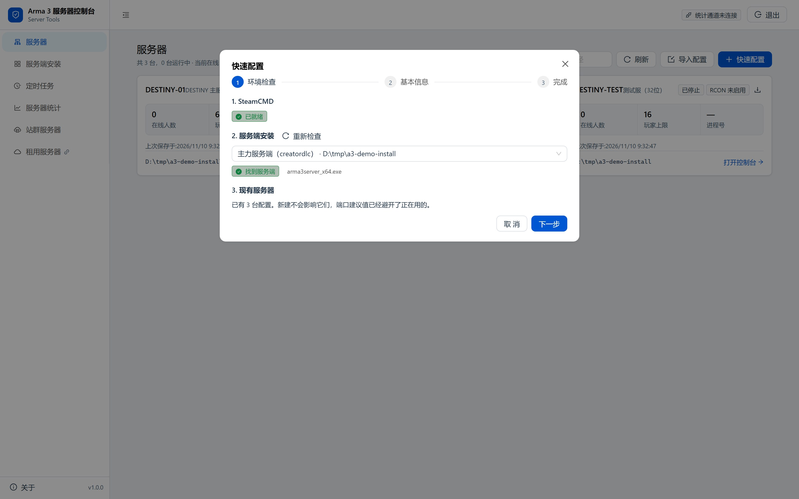
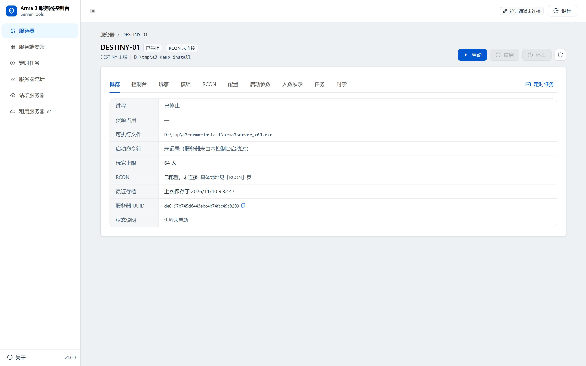
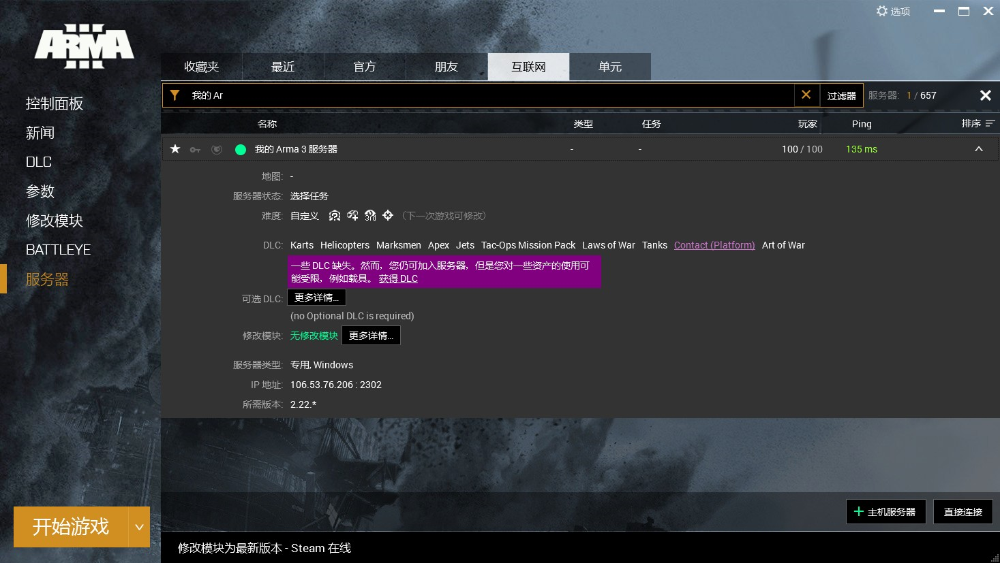
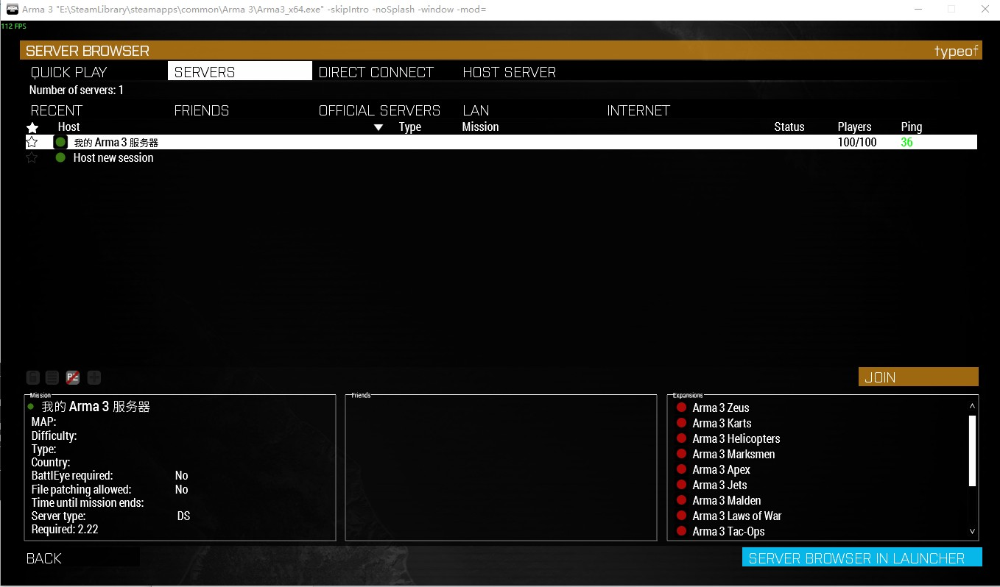
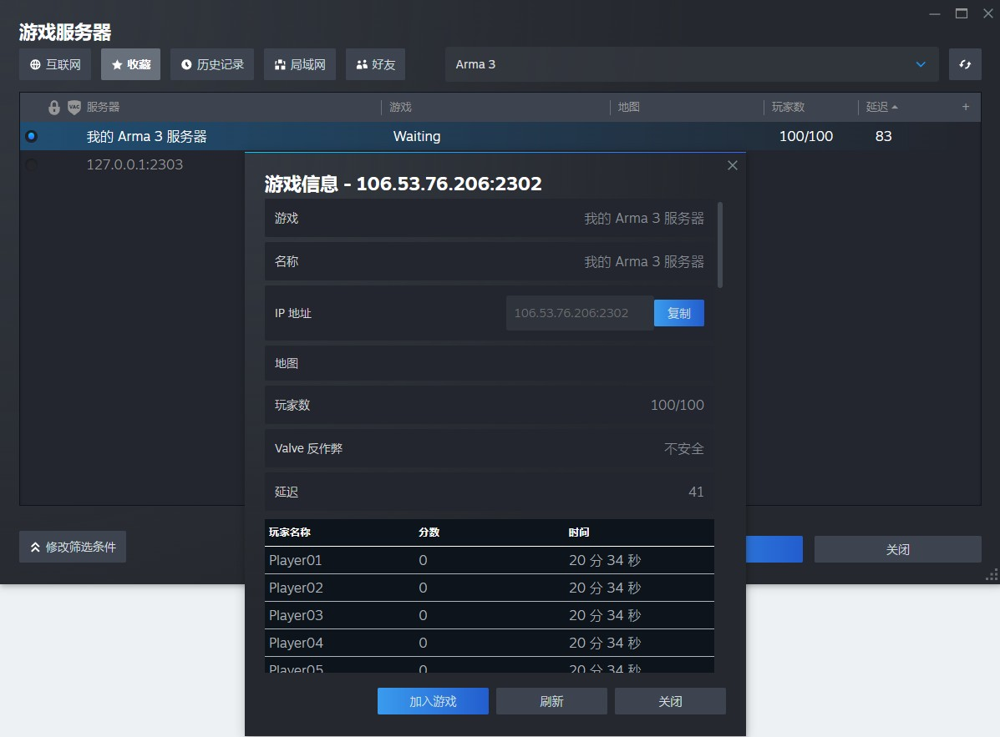

# Arma 3 服务器控制台

一套在浏览器里管理 Arma 3 专用服务器的工具。**不用装客户端、不用记命令行**——双击启动，打开网页，剩下的点鼠标就行。

覆盖从「下载服务端」到「看玩家统计」的全流程：SteamCMD 装服、配置编辑、启停控制、模组下载、RCON、定时任务、玩家统计、封禁管理。



---

## 目录

- [它解决什么问题](#它解决什么问题)
- [功能一览](#功能一览)
- [下载哪个包](#下载哪个包)
- [快速开始（5 步）](#快速开始5-步)
- [使用说明](#使用说明)
  - [第一次：登记服务端安装](#第一次登记服务端安装)
  - [建第一台服务器](#建第一台服务器)
  - [日常：启动、停止、看控制台](#日常启动停止看控制台)
  - [模组：创意工坊一键下载](#模组创意工坊一键下载)
  - [定时任务：定点重启](#定时任务定点重启)
  - [统计：玩家数据从哪来](#统计玩家数据从哪来)
  - [人数展示：服务器列表显示指定人数](#人数展示服务器列表显示指定人数)
- [架构](#架构)
- [数据存在哪](#数据存在哪)
- [常见问题](#常见问题)
- [版本与校验](#版本与校验)

---

## 它解决什么问题

开 Arma 3 服务器的人大概都经历过这些：

| 痛点 | 这个工具的做法 |
|---|---|
| 每台服务器都要手改 `server.cfg`，改错一个引号就起不来 | 表单化编辑，字段带说明和校验，保存前先备份 |
| 多开服务器时，每台都要重新下载一份 8~10 GB 的服务端 | 「服务端安装」独立成库，**一份安装给任意多台服务器共用** |
| 创意工坊模组要自己找 ID、拼 `-mod=` 参数 | 填 ID 或链接，自动下载、自动拼参数 |
| 想看谁在玩、玩多久，只能翻 RPT 日志 | 游戏内扩展实时上报，网页上看在线列表和排行榜 |
| 定时重启要写计划任务，还要处理「重启时有人在玩」 | 内置任务系统，可设「无人时重启」 |
| 服务器在机房，人在家里 | 网页访问，手机也能开 |

---

## 功能一览

| 模块 | 能做什么 |
|---|---|
| **服务器** | 多实例管理、启动/停止/重启、进程状态与 CPU/内存占用、崩溃后状态还原 |
| **服务端安装** | SteamCMD 下载/校验/更新服务端；一份安装可被多台服务器共用；创意工坊目录自动纳入模组扫描 |
| **控制台** | 实时跟踪 RPT 日志输出（引擎自己的控制台窗口抓不到，只能走 RPT） |
| **玩家** | 在线玩家列表、连接/断开记录、在线时长 |
| **模组** | 创意工坊按 ID 下载、本地模组登记、`-mod=` 参数自动生成、模组签名检查 |
| **RCON** | 连接 BattlEye RCON、执行命令、可视化命令面板（踢人、广播、改任务） |
| **配置** | `server.cfg` 全字段表单编辑、`basic.cfg` 网络参数、启动参数（含预设） |
| **启动参数** | 按 schema 生成命令行，冲突项会提示（比如同时开两个占用同端口的实例） |
| **人数展示** | 让服务器列表显示指定的人数（A2S 应答层处理，可选） |
| **任务** | 定时重启、定时执行命令、定点开图 |
| **封禁** | 本地封禁列表、批量导入导出、跨服共享封禁 |
| **站群服务器** | 多台服务器的统一入口与端口中转 |
| **统计** | 玩家库、游戏时长、击杀/死亡排行榜、在线人数曲线、时段热力图 |



---

## 下载哪个包

到 [Releases](../../releases) 页面下载最新版本。同一版本提供三个包，**按你的情况选一个就够**：

| 文件 | 大小 | 适用场景 | 前置要求 |
|---|---|---|---|
| `...-win-x64-standalone.zip` | 约 49 MB | **推荐**。只在本机用 | 无，解压即用 |
| `...-win-x64-public.zip` | 约 49 MB | 想在局域网 / 公网访问 | 无，解压即用 |
| `...-win-x64-framework.zip` | 约 17 MB | 已经装了 .NET 8 | .NET 8 + ASP.NET Core 8 Runtime |

**两个「大包」的区别只有一行配置**：

```jsonc
// standalone：只允许本机访问
"Urls": "http://127.0.0.1:5080"

// public：允许任何来源访问（防火墙/安全组要放行 5080）
"Urls": "http://0.0.0.0:5080"
```

包里的 `extension\steamcmd.exe` 是 Valve 官方的 5 MB 引导器，首次「下载服务端」时它会自己拉取完整组件（约 130 MB），不需要你另外准备。

---

## 快速开始（5 步）

### 1. 解压

解压到**路径不含中文**的目录，例如 `D:\Arma3Tools`。

> 为什么不能有中文：SteamCMD 在非 ASCII 路径上会静默失败，表现为「下载完成但目录是空的」。

### 2. 双击 `start.cmd`

```
D:\Arma3Tools\
├─ Arma3ServerTools.Web.exe
├─ start.cmd          ← 双击这个
├─ appsettings.json
├─ extension\         ← steamcmd.exe 与统计扩展
├─ wwwroot\           ← 界面文件
└─ ...
```

会弹出一个黑色控制台窗口。**这个窗口就是服务本体，关掉它服务就停了**。

### 3. 记下初始密码

窗口里会打印一行：

```
warn: CoreStartupService[0]
      已生成管理员密码: xxxxxxxxxxxxxxxx  —— 仅显示这一次，凭据文件 D:\Arma3Tools\admin.json
```

**只显示这一次**。密码以 PBKDF2 哈希存在 `admin.json` 里，读不出来；忘了就删掉 `admin.json` 重启，会重新生成一个。

### 4. 打开浏览器

访问 **http://127.0.0.1:5080**



输入刚才那串密码。用户名恒为 `admin`，不用填。

### 5. 登记服务端安装

见下一节。

---

## 使用说明

### 第一次：登记服务端安装

**「服务端安装」是这台工具的核心概念**：它代表磁盘上的一份 Arma 3 专用服务器文件（含 `arma3server_x64.exe` 的那个目录）。一份安装可以被任意多台服务器共用——**不需要为第二台服务器重新下载 8~10 GB**。

进入左侧「服务端安装」→ 点右上角「登记安装」：

1. **安装目录**：手填路径，或者点「浏览」选。
   - 目录**不存在会自动创建**（需要写权限）
   - 目录可以是空的，登记完再点「安装」让 SteamCMD 下载
2. **显示名**：留空就用目录名。用来区分「creatordlc 分支」「32 位那份」这类情况。

登记完成后，这一行显示「未安装」。点该行的 **「安装」** 按钮，SteamCMD 开始下载：

- 首次约 **8~10 GB**，耗时取决于带宽
- 进度显示在页面上方的 SteamCMD 卡片里
- 下载完成后状态变成「可用」

**SteamCMD 账号**：如果下载需要登录（大部分情况需要），点 SteamCMD 卡片上的「修改账号」填入 Steam 账号密码。密码加密保存在本地，不会出现在任何接口响应里。

---

### 建第一台服务器

回到「服务器」页，点右上角 **「快速配置」**：



向导会依次问：

| 步骤 | 内容 |
|---|---|
| 1 | 环境自检（SteamCMD 是否就绪、安装是否可用） |
| 2 | 选一份已登记的服务端安装 |
| 3 | 服务器名、主机名、端口（自动挑没被占用的）、人数上限 |
| 4 | 确认并创建 |

创建完会写出 `server.cfg`、`basic.cfg` 等配置文件，配置藏在数据根的 `config\<uuid>.json` 里。

> 端口规则：游戏端口默认 2402，**A2S 查询端口 = 游戏端口 + 1**（2403）。两台服务器不能共用端口。

---

### 日常：启动、停止、看控制台

点服务器卡片进入详情页，有 10 个标签页：



| 标签 | 用途 |
|---|---|
| **概览** | 进程状态、资源占用、可执行文件、启动命令行、玩家上限、RCON 地址 |
| **控制台** | 实时 RPT 输出（引擎自己的窗口抓不到文字，唯一实时源是 RPT） |
| **玩家** | 当前在线、历史连接记录、时长 |
| **模组** | 当前生效的模组列表、加载顺序、下载入口 |
| **RCON** | 连接 BattlEye、执行命令、可视化命令面板 |
| **配置** | `server.cfg` 表单编辑（带说明与校验） |
| **启动参数** | 命令行参数表单，含预设与冲突检查 |
| **人数展示** | A2S 显示人数（可选，见下方说明） |
| **任务** | 这台服务器的定时任务 |
| **封禁** | 本服封禁列表 |

右上角三个按钮：**启动 / 重启 / 停止**。启动后状态从「已停止」变成「运行中」，进程号与资源占用随之刷新。

---

### 模组：创意工坊一键下载

两种情况：

**A. 从创意工坊下载**
1. 进入服务器详情 → 「模组」
2. 填创意工坊 ID（或粘贴工坊链接，自动解析 ID）
3. 点下载，SteamCMD 会拉取到 `<steamcmd目录>\steamapps\workshop\content\107410\`
4. 下载完自动登记为可用模组，勾选后自动拼 `-mod=` 参数

**B. 用本地已有模组**
1. 把 `@模组名` 目录放进服务器的 `-mod=` 搜索路径
2. 「模组」页点「添加本地模组」，或让它自动扫描

模组勾选顺序决定加载顺序，界面上可以拖动调整——**顺序错了会导致依赖失效，这是 Arma 最常见的「模组装了但不生效」原因**。

---

### 定时任务：定点重启

左侧「定时任务」或服务器详情 → 「任务」：

| 字段 | 说明 |
|---|---|
| 触发时间 | 每天定点，或 Cron 表达式 |
| 动作 | 重启 / 停止 / 启动 / 执行 RCON 命令 / 切换任务图 |
| 条件 | 可设「在线人数为 0 时才执行」，避免踢人 |

典型配置：`每天 05:00 重启，条件：在线人数 = 0`。

---

### 统计：玩家数据从哪来

统计不是靠解析日志，而是**游戏内扩展主动上报**：

```
游戏服务器 (arma3server_x64.exe)
   └─ callExtension "DestinyServerMonitoring"
        └─ DestinyServerMonitoring_x64.dll     ← 部署在服务器目录
             ├─ 共享内存（同机最快，~0.0004 ms）
             ├─ UDP（跨机，~0.0032 ms）
             ├─ HTTP（通用兜底，~9.2 ms）
             ├─ 窗口消息（兼容旧版）
             └─ 文件投递（断网时落盘，恢复后补录）
                  ↓
        控制台宿主 → SQLite → 网页
```

**同机部署时什么都不用配**——共享内存通道自动生效。跨机才需要配 `monitoring.conf` 里的 Endpoint。

部署方式：服务器详情 → 「模组」页的「统计模组 @destiny_server」卡片，一键生成并部署：

- 打包 `@destiny_server`（含 `addons\destiny_server.pbo`）
- 复制 `DestinyServerMonitoring_x64.dll` 到服务器目录
- 写入 `monitoring.conf`，令牌自动取自宿主的 `monitoring-token.txt`
- 在启动参数里加 `-serverMod=@destiny_server`

然后在「服务器统计」页就能看到玩家库、在线曲线、排行榜。

### 人数展示：服务器列表显示指定人数

服务器列表里那个 **`100/100`** 不是真实在线人数，而是控制台在 **A2S 查询应答**里替换掉的值。客户端、启动器、第三方查询工具，看到的都是这个数。

**Arma 3 启动器 →「互联网」列表**



**游戏内服务器浏览器**



**第三方查询工具**（连玩家列表一起伪造，条数 = 人数）



#### 配置

服务器详情 → **「人数展示」**标签：

| 项 | 说明 |
|---|---|
| 模式 | `fake` 永远伪造 · `real` 不伪造（等于临时下线，但不卸载） · `auto` 空服时伪造、有真人后显示真实值 |
| 人数 | 对外显示的玩家数（0–255） |
| 上限 | 对外显示的上限（0–255），自动抬到 ≥ 人数 |
| bots | A2S 的 `bots` 字段 |
| 前缀 | 假玩家名前缀，生成 `Player01`、`Player02`… |

改完 **2 秒内生效**，不用重启服务器，也不用重新注入。

#### 注意事项

- **上限只是展示值**。真实进服容量仍由启动参数 `-maxPlayers` 决定。显示 `100/100` 但实际只配了 32 个位置时，第 33 个人进不来。
- **游戏内「互联网」标签只伪造得了上限，伪造不了人数**。那个通道走 Steam 后端，`ISteamGameServer` 只提供 `SetMaxPlayerCount` / `SetBotPlayerCount`，**没有** `SetPlayerCount`——玩家数由 Steam 按真实鉴权连接统计。所以 Internet 列表会显示 `0/100`（真实人数 / 伪造上限），而「局域网」「直连」「启动器」「第三方站点」走 A2S，整段应答都能重写，显示 `100/100`。
- 32 位服务端上不修改 Steam 后端（实测会导致 `0xc0000005` 崩溃），只做 A2S 部分。
- 该功能可随时用 `enabled=0` 关闭，DLL 不用卸载。

---

## 架构

```
┌──────────────────────────────────────────────────────────┐
│  浏览器（React 18 + Ant Design 5）                        │
│  服务器列表 / 详情 / 安装 / 任务 / 统计 / RCON             │
└────────────────────────┬─────────────────────────────────┘
                         │ HTTP + SSE（实时推送）
┌────────────────────────▼─────────────────────────────────┐
│  Arma3ServerTools.Web —— ASP.NET Core 8 宿主（net8.0-windows）
│                                                           │
│  ┌─────────────────────────────────────────────────────┐  │
│  │  Arma3ServerTools.Core —— 纯逻辑，无 UI 依赖          │  │
│  │  · 配置 schema 与校验      · 进程生命周期            │  │
│  │  · SteamCMD 驱动           · 统计聚合                │  │
│  │  · PBO 打包                · RCON 会话               │  │
│  │  （1078 条单元测试覆盖这一层）                        │  │
│  └─────────────────────────────────────────────────────┘  │
│                                                           │
│  端点层：/api/servers  /api/installs  /api/steamcmd       │
│          /api/config   /api/tasks     /api/statistics     │
│          /api/rcon     /api/bans      /api/relay          │
└───┬──────────────┬──────────────┬──────────────┬─────────┘
    │              │              │              │
    ▼              ▼              ▼              ▼
arma3server    steamcmd.exe   SQLite 数据库   共享内存/UDP/HTTP
_x64.exe       下载/更新     玩家库·统计      ▲
（子进程）     服务端与模组                    │
                                    DestinyServerMonitoring_x64.dll
                                          （游戏内 callExtension）
```

### 为什么这么分层

| 设计 | 原因 |
|---|---|
| Core 与 Web 分离 | Core 不依赖 UI 和 HTTP，可以纯单元测试。1078 条测试全在这一层，改逻辑不用起服务器 |
| 前端产物只在 `dotnet publish` 时构建 | 开发时前端跑 vite dev server（热更新 200ms），改后端不会因为等前端构建而变慢 |
| 统计走扩展而非日志解析 | 日志格式随版本变，且拿不到结构化数据；扩展能直接读到引擎状态 |
| 多通道上报（共享内存→UDP→HTTP→文件） | 同机走最快的共享内存，跨机走 UDP，网络不通时落盘补录，**任何一环挂掉数据不会静默丢失** |
| 服务端安装独立成库 | 从交互上消灭「为第二台服务器重下 8~10 GB」这条路径 |

### 技术栈

| 层 | 技术 |
|---|---|
| 前端 | React 18、Ant Design 5、React Router 6、ECharts 6、Vite 5 |
| 宿主 | ASP.NET Core 8（`net8.0-windows`）、Minimal API、SSE |
| 逻辑 | .NET 8、Quartz（任务调度）、Microsoft.Data.Sqlite |
| 游戏扩展 | .NET Framework 4.8、`RVExtension` 原生导出 |
| 打包 | `dotnet publish` + vite build |

---

## 数据存在哪

默认就在**程序所在目录**。换发布包时想保留数据，设环境变量 `ARMA3_TOOLS_HOME` 指向固定位置：

```powershell
set ARMA3_TOOLS_HOME=D:\Arma3ToolsData
```

| 文件 / 目录 | 内容 |
|---|---|
| `admin.json` | 管理员密码（PBKDF2 哈希，无明文） |
| `config\<uuid>.json` | 每台服务器的完整配置 |
| `destiny_players.db` | 玩家库 |
| `destiny_statistics.db` | 统计与战绩 |
| `monitoring-token.txt` | 统计上报令牌（扩展用） |
| `moduleScanPath.json` | 模组扫描路径 |

> ⚠️ `config` 目录是**全量扫描 `*.json`** 的。别往里放备份文件——它会被当成第二台服务器读进去。

**备份**：整个数据根目录复制走即可。换机器时连同发布包一起拷过去，配置和玩家数据都在。

---

## 常见问题

<details>
<summary><b>双击 start.cmd 闪一下就没了</b></summary>

端口被占用。检查 5080 是否已被别的程序（或另一个本工具实例）占用：

```powershell
netstat -ano | findstr :5080
```

要么关掉占用者，要么改 `appsettings.json` 里的 `Urls` 换端口。
</details>

<details>
<summary><b>忘记管理员密码了</b></summary>

删掉数据根下的 `admin.json`，重启。会生成新密码并打印在控制台。
</details>

<details>
<summary><b>服务端下载完成，但目录是空的</b></summary>

99% 是路径含中文或特殊字符。SteamCMD 在非 ASCII 路径上不报错、只是下到别处。把安装目录改成纯英文路径重试。
</details>

<details>
<summary><b>模组装了但游戏里没生效</b></summary>

三个常见原因：

1. **加载顺序**：依赖模组必须排在被依赖者前面
2. **签名不匹配**：服务器开了 `verifySignatures`，模组必须带 `.bikey` 且放在 `keys\` 下
3. **只装了客户端版**：创意工坊里有些模组分 server/client 两份，服务器要装 server 那份
</details>

<details>
<summary><b>统计页一直是空的</b></summary>

按顺序检查：

1. 服务器详情 → 「模组」→ 统计模组是否已部署（DLL 在服务器目录、`-serverMod=@destiny_server` 已加）
2. 右上角「统计通道」是否绿——红色说明宿主没收到数据
3. 游戏服 RPT 里搜 `DestinyServerMonitoring`，看扩展加载有没有报错
</details>

<details>
<summary><b>局域网/手机访问不了</b></summary>

1. 用 `public` 包，或把 `appsettings.json` 的 `Urls` 改成 `http://0.0.0.0:5080`
2. 放行防火墙：

```powershell
New-NetFirewallRule -DisplayName "Arma3Tools 5080" -Direction Inbound `
    -Protocol TCP -LocalPort 5080 -Action Allow
```

3. 云服务器还要在控制台安全组里放行 5080

⚠️ 默认是**明文 HTTP**，密码和会话 cookie 明文过网。长期对外请在前面套一层 HTTPS 反向代理。
</details>

<details>
<summary><b>能管理几台服务器？</b></summary>

没有硬限制，取决于机器性能。每台 Arma 3 服务器是独立进程，通常一台 16 GB 内存的机器跑 3~5 台中等规模的服务器没问题。
</details>

---

## 版本与校验

每个 Release 附一份 `SHA256SUMS-<版本>.txt`。下载后核对：

```powershell
Get-FileHash .\Arma3ServerTools-1.0.0-win-x64-standalone.zip -Algorithm SHA256
```

与清单里的值比对，不一致就不要运行。

**系统要求**

| 项 | 要求 |
|---|---|
| 操作系统 | Windows 10 1809+ / Windows Server 2019+ / Windows 11 |
| 架构 | x64 |
| 内存 | 工具本身约 150 MB；每台 Arma 3 服务器另需 2~4 GB |
| 磁盘 | 工具约 120 MB；每份服务端安装 8~10 GB |
| 其他 | 无需安装 .NET（standalone 包已内置） |

---

## 关于

本项目最初是 WinForms 桌面工具，2026 年重写为本地 Web 控制台。当前版本只维护 Web 版。

- 问题反馈与建议：请在本仓库开 Issue
- 本仓库只发布**编译好的发行版**，不包含源代码
